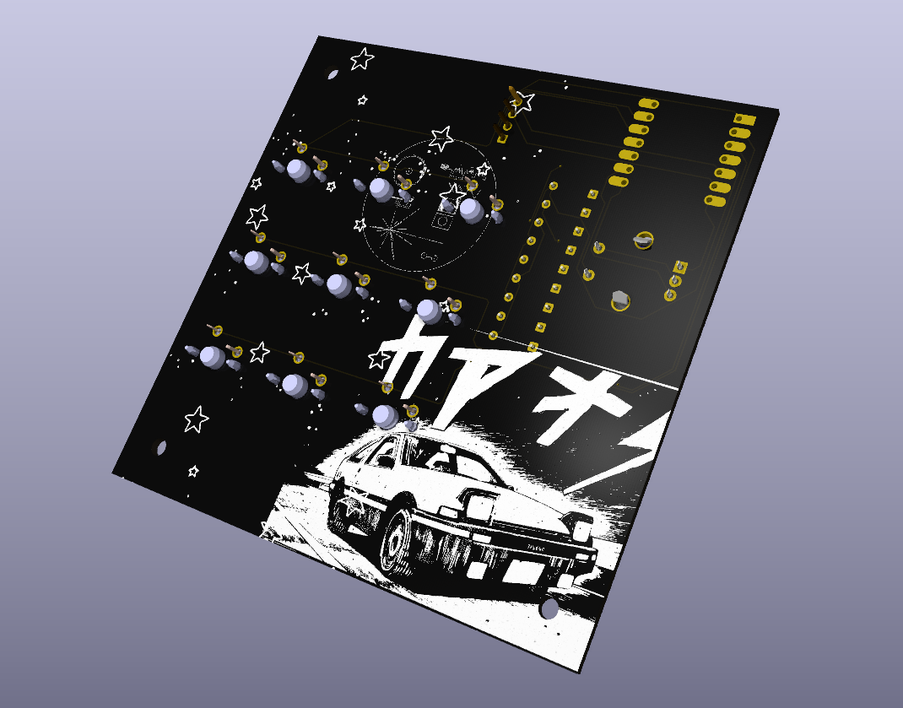

# HackPad

HackPad is a custom-built 9-key macropad featuring a rotary encoder, an OLED display, a custom-designed PCB, and a fully 3D-printed enclosure.

The project was designed from scratch, including the schematic, PCB layout, custom PCB artwork, enclosure, and firmware.

## Features

- 9 mechanical keyboard switches in a 3×3 layout
- Rotary encoder with push-button functionality
- 0.91-inch I2C OLED display
- Seeed Studio XIAO RP2040
- Custom-designed PCB
- Custom front and back silkscreen artwork
- 3D-printed two-part enclosure
- Programmable keys using CircuitPython

---

## Project Preview

### Enclosure


---

## PCB

The PCB was designed in KiCad and contains the complete hardware for the HackPad, including the 3×3 switch matrix, rotary encoder, OLED display, and Seeed Studio XIAO RP2040.


The front of the PCB contains the main components and custom silkscreen artwork, including the Hack Club flag and other design elements.

### Back Artwork



The back of the PCB features large custom monochrome artwork integrated directly into the PCB silkscreen.

---

## Hardware

| Component | Quantity |
|---|---:|
| Seeed Studio XIAO RP2040 | 1 |
| Mechanical switches | 9 |
| Keycaps | 9 |
| Rotary encoder | 1 |
| 0.91-inch I2C OLED display | 1 |
| Diodes | 9 |
| Custom PCB | 1 |
| 3D-printed top enclosure | 1 |
| 3D-printed bottom enclosure | 1 |
| M3 screws | 6 |
| M3 heat-set inserts | 6 |

---

## Firmware

The firmware is written in CircuitPython and is located in:

`Firmware/main.py`

The firmware handles the 9 mechanical switches, rotary encoder, OLED display, and macropad functionality.

To use the firmware, install CircuitPython on the XIAO RP2040 and copy the required libraries and `main.py` to the board.

---

## Repository Structure

```text
HackPad/
├── CAD/
│   └── Hackpadoverall.step
│
├── Firmware/
│   └── main.py
│
├── PCB/
│   ├── Hackpad.kicad_pcb
│   ├── Hackpad.kicad_pro
│   └── Hackpad.kicad_sch
│
├── Production/
│   ├── Bottom.stl
│   ├── Top.stl
│   ├── gerbers.zip
│   └── main.py
│
├── images/
│   ├── caseback.png
│   ├── caseside.png
│   ├── casetop.png
│   ├── pcbback.png
│   └── pcbtop.png
│
└── README.md
