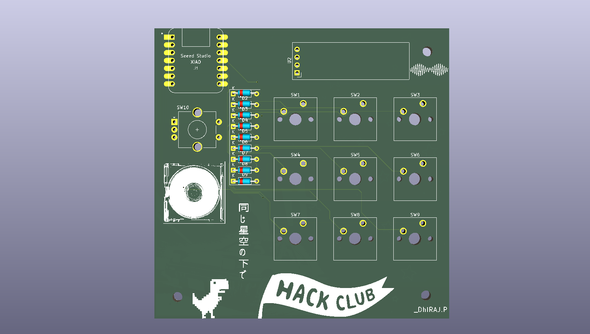
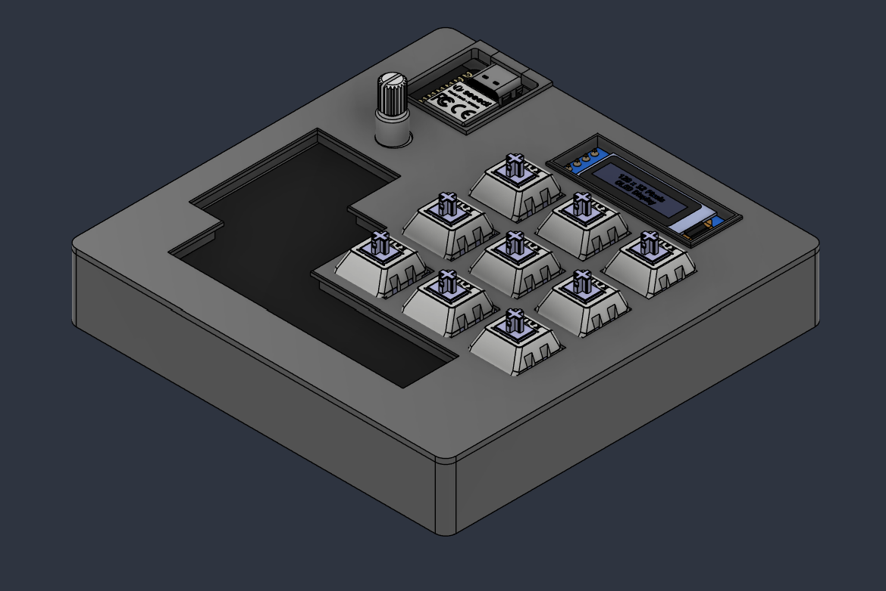
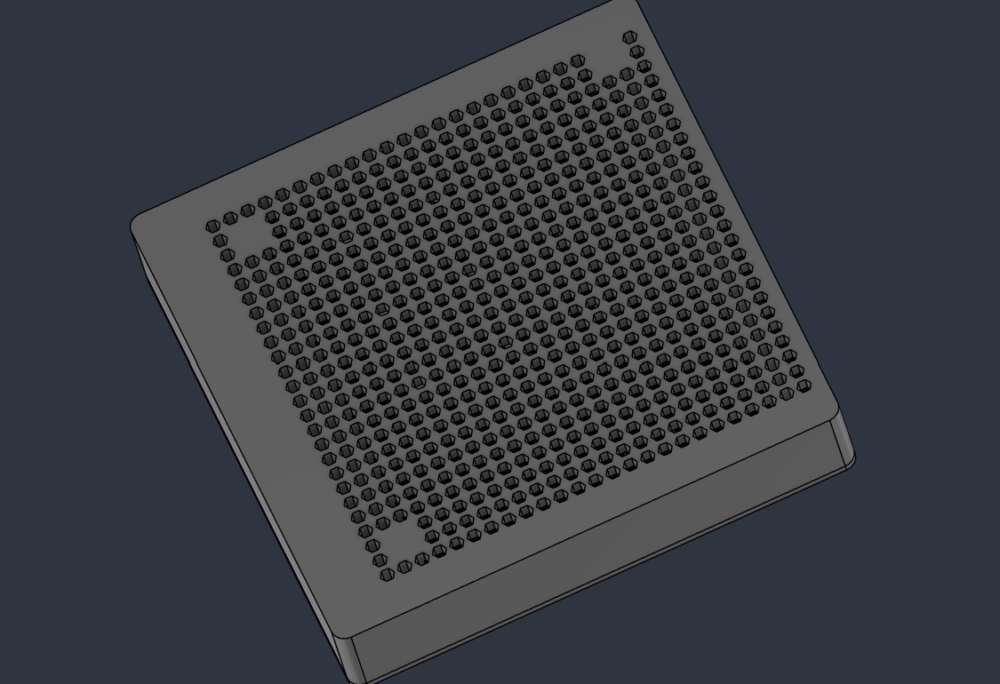

# HackPad

HackPad is a custom-built 9-key macropad featuring a rotary encoder, an OLED display, a custom-designed PCB, and a fully 3D-printed enclosure.

The project was designed from scratch, including the schematic, PCB layout, custom PCB artwork, enclosure, and firmware.

#novemer 15 2026   selected components and completed pcb designing succesfully
time spent - 4 hours 

today i selected i want to do a hackpad projecct so i got to work and selected what components i wanted to use what keycaps buttons mcu display after everything was selected i designed a neat schematic in kicad routed the pcb and completed the bill of materials 

---




#november 16 2026 issues with pcb and started designing the case 

today when looking at the pcb schematic i noticed problem with xiao library in kicad not loading properly after watching so much yt videos i fixed the issue by reinstalling the xiao library after fixing that i got started to design the case that fits for the pcb with cutouts for display and all the keys






---

#november 17 2026      Checked everything ready to submit


 ran simulations today every part is working all the 3d models fitted successfully and everything's done all the parts list and pricing is under budget I am ready to submit my work


The back of the PCB features large custom monochrome artwork integrated directly into the PCB silkscreen.

---

## Hardware

| Component | Quantity |
|---|---:|
| Seeed Studio XIAO RP2040 | 1 |
| Mechanical switches | 9 |
| Keycaps | 9 |
| Rotary encoder | 1 |
| 0.91-inch I2C OLED display | 1 |
| Diodes | 9 |
| Custom PCB | 1 |
| 3D-printed top enclosure | 1 |
| 3D-printed bottom enclosure | 1 |
| M3 screws | 6 |
| M3 heat-set inserts | 6 |

---

## Firmware

The firmware is written in CircuitPython and is located in:

`Firmware/main.py`

The firmware handles the 9 mechanical switches, rotary encoder, OLED display, and macropad functionality.

To use the firmware, install CircuitPython on the XIAO RP2040 and copy the required libraries and `main.py` to the board.

---

## Repository Structure

```text
HackPad/
├── CAD/
│   └── Hackpadoverall.step
│
├── Firmware/
│   └── main.py
│
├── PCB/
│   ├── Hackpad.kicad_pcb
│   ├── Hackpad.kicad_pro
│   └── Hackpad.kicad_sch
│
├── Production/
│   ├── Bottom.stl
│   ├── Top.stl
│   ├── gerbers.zip
│   └── main.py
│
├── images/
│   ├── caseback.png
│   ├── caseside.png
│   ├── casetop.png
│   ├── pcbback.png
│   └── pcbtop.png
│
└── README.md
